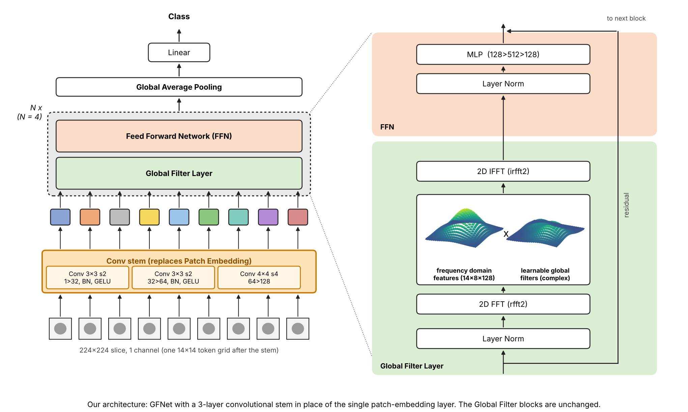
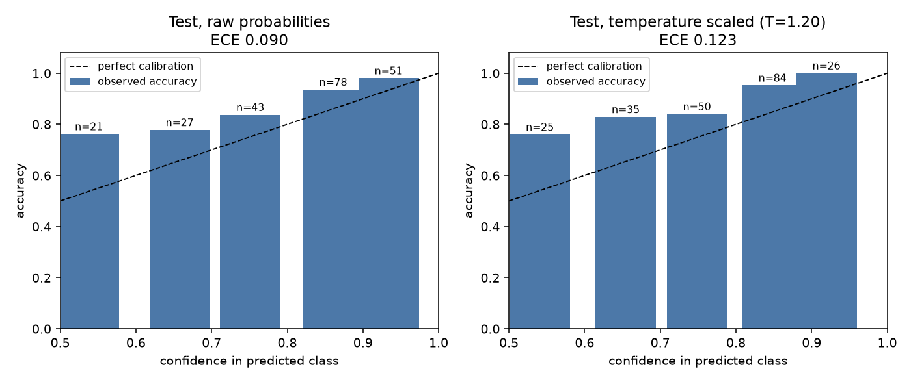
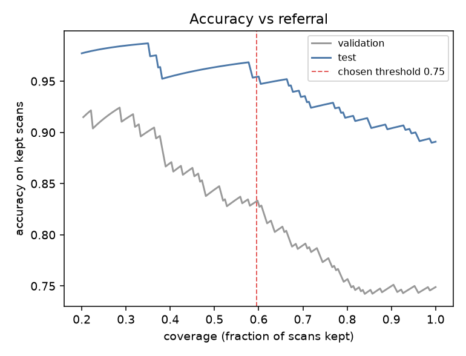
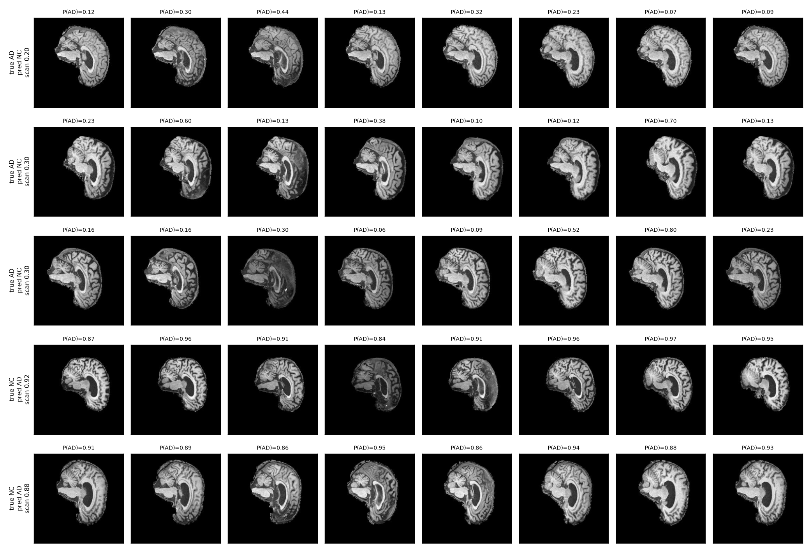
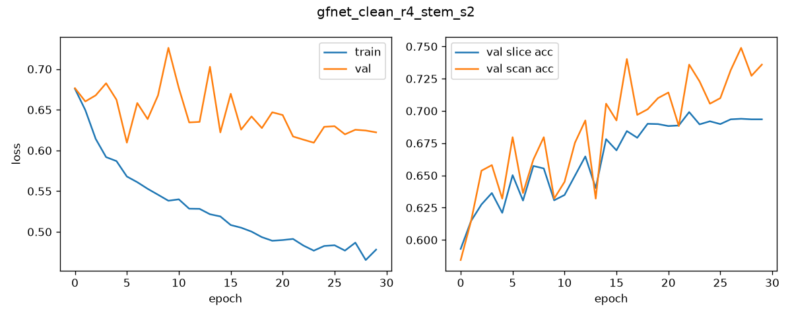

# GFNet for Alzheimer's Classification on ADNI (AD vs NC)

**Author:** Sasha Borislavov (48026048)  
**Course:** COMP3710 Pattern Recognition and Analysis (2026), University of Queensland  
**Difficulty:** Hard (GFNet, Rao et al., 2023)

---

## Table of Contents
- [Overview](#overview)
- [Problem Statement](#problem-statement)
- [Algorithm Description](#algorithm-description)
- [Architecture Visualization](#architecture-visualization)
- [How It Works](#how-it-works)
- [Dependencies](#dependencies)
- [Project Structure](#project-structure)
- [Installation](#installation)
- [Dataset & Preprocessing](#dataset--preprocessing)
- [Training Strategy](#training-strategy)
- [Usage](#usage)
- [Training Hardware](#training-hardware)
- [Results and Ablation](#results-and-ablaiton)
- [Calibration and Referral](#calibration-and-referral)
- [Example Results and Analysis](#example-results-and-analysis)
- [Training Performance and Plots](#training-performance-and-plots)
- [Notes on Preprocessing & Splits](#notes-on-preprocessing--splits)
- [Further Development](#further-development)
- [Feasibility Review](#feasibility-review)
- [AI Usage Disclosure](#ai-usage-disclosure)
- [References](#references)
- [Acknowledgements](#acknowledgements)

---

## Overview

This project aims to classify brain MRI scans from the ADNI dataset [4] as Alzheimer's disease (AD) or normal control (NC). The main model I will use is a Global Filter Network (GFNET) implemented in PyTorch, which includes the FFT-based global filter layers. During experimentation, I found that using a plain GFNet overfits badly on the small provided dataset, and so the final model used adds a small convolutional stem in front of the GFNet blocks. The plain GFNet will still be reported (instead as an ablation) together with a stem-only model (without GFNet blocks) and also a smaller baseline CNN.

The main findings of this project: (scan-level accuracy on a patient-independent test set, mean of 3 seeds):

| Model | Test scan accuracy |
|---|---|
| Plain GFNet | 0.706 |
| Conv stem only (no GFNet blocks) | 0.780 |
| Baseline CNN | 0.823 |
| **Conv stem + GFNet (final)** | **0.888** |

The given target of atleast 80% test accuracy on a patient-independant test set is met by the final model. Limitiations found during experimentation (like a gap between validation and test accuracy that I couldn't fully explain) can be found in [Results and Ablation](#results-and-ablation).


---

## Problem Statement

**Task:** Binary classification of ADNI brain MRI into AD (label 1) and NC (label 0). The data are 2D greyscale slices (224 x 224), with 20 slices per scan. A model predicts each slice, and a scan's prediction is the mean of its 20 slice probabilities. All reported accuracies are scan-level unless stated otherwise, because a scan is the unit a clinician would care about.

**Why is this task hard?**
- **Too few patients:** There are 680 patients in total and there is also only 475 patients in the training set. The slices from one patient are also near duplicates, so the actual effective sample size is the number of patients and not the number of slices.
- **Patient leakage:** The provided train/test split put the same patients in both sets (see [Dataset & Preprocessing](#dataset--preprocessing)), which makes test accuracy unreliable.
- **Overconfidence is dangerous:** Because this is a research prototype and not a diagnotic tool the key engineering question is whether the model's confidence actually reflects its reliability, so that uncertain scans can be flagged for a human to review.

**Success criteria** (from the feasibility review):
1. At least 80% scan-level test accuracy on a patient-independent test set, with slice accuracy also reported.
2. No patient leakage, enforced by an assertion in the data-loading code.
3. Calibration evaluated with a reliability diagram and ECE, against a CNN baseline.
4. Confidence-based referral evaluated, with the threshold chosen on the validation set.
5. Peak GPU memory, parameter count, inference time and total GPU-hours reported.

---

## Algorithm Description

### GFNet

GFNet [1] is a neural network for images built around a classic signal-processing idea: filtering in the frequency domain. The image is first turned into a 14 x 14 grid of "tokens", each holding 128 numbers (channels). The main part of the network is then a stack of 4 identical blocks, and each block contains a **global filter layer**. For each channel, the layer does the following:

1. Take the 2D FFT of the 14 x 14 grid, `X = rfft2(x)`.
2. Multiply the spectrum point by point by a filter, `X_tilde = X * K`.
3. Take the inverse FFT, `x = irfft2(X_tilde)`.

This is the same as filtering in a standard signal processing course, except that the filter `K` is not designed by hand. Its values are learned during training, so the network chooses which frequencies to keep or suppress. The authors describe it as "an element-wise multiplication between frequency-domain features and learnable global filters" [1].

**Why is it useful?** By the convolution theorem, multiplying spectra is the same as a circular convolution in the spatial domain, so the layer is "equivalent to a depthwise global circular convolution with the filter size H x W" [1]. A normal convolutional layer only looks at a small window, such as 3 x 3. Here the filter covers the whole grid, so every output value depends on every input value. The FFT makes this cheap: the cost is O(D L log L), where L is the number of tokens and D is the number of channels, compared with O(D L^2) for direct convolution with a whole-image kernel [1].

**Why is the filter 14 x 8?** Image values are real, so the spectrum is conjugate symmetric and, in the paper's words, "we can take only the half of the values in the X but preserve the full information at the same time" [1]. `rfft2` keeps only that half, so the 14 frequencies along the width become 8, and the learned filter has shape 14 x 8 x 128.

**The rest of the model:** After each global filter layer, a small neural network (an MLP) processes each token, and the block's input is added to its output. After the last block the tokens are averaged and a linear layer gives the probability of Alzheimer's disease.

**My implementation:** I implemented the layer in PyTorch (`modules.py`), with help from AI model Claude (Anthropic) as described in the AI Usage Disclosure. The complex filter is stored as a real tensor with a last dimension of size 2 (real and imaginary parts) and converted with `torch.view_as_complex`. To check the layer, I set the filter to all ones, so it should change nothing, and the output matched the input to within 6e-7. My model is much smaller than the paper's (4 blocks of width 128, 702,082 parameters), because there are only 475 training patients.

### Adaptation: convolutional stem

GFNet turns the image into a grid of tokens before the Global Filter blocks. The paper does this with one 16 x 16 convolution with stride 16 (a "patch embedding"), which cuts the image into separate squares and converts each to 128 numbers [1]. I replaced it with three small convolutions that produce the same 14 x 14 x 128 token grid, but look at small overlapping neighbourhoods and shrink the image gradually (224 to 112 to 56 to 14):

| Layer | Output size |
|---|---|
| Input | 1 x 224 x 224 |
| Conv 3x3, stride 2, 1 to 32, BatchNorm, GELU | 32 x 112 x 112 |
| Conv 3x3, stride 2, 32 to 64, BatchNorm, GELU | 64 x 56 x 56 |
| Conv 4x4, stride 4, 64 to 128 | 128 x 14 x 14 |

Everything after the token grid (positional embedding, 4 Global Filter blocks, mean pooling, linear classifier) is unchanged. The full model has 819,394 parameters.

**Why do we need a stem?** Becuase the dataset has too few training patients, the plain GFNet overfit terribly. It didn't imrpove with smaller widths, weight decay, dropout, stochastic depth, label smoothing, mixup, strong augmentation, a warmup and cosine schedule, finer patches, ANYTHING! I found that early convolutions could help n this setting because they add a local inductive bias (nearby pixels are related, so the small filters are used everywhere) and use overlapping receptive fields, which gives the model useful low-level features like edges and textures before the global filters mix information.

### Baseline CNN

Four blocks of Conv3x3, BatchNorm, ReLU and max-pool (widths 16, 32, 64, 128), global average pooling, dropout 0.3 and a linear layer (97,890 parameters). It is trained with the same recipe as the GFNet models.

---

## Architecture Visualization



*Figure 1. The final model as drawn in the layout of the original GFNet figure.*

## How It Works

1. **Split:** `make_splits.py` pools all provided scans, groups them by ADNI subject and makes a stratified 70/15/15 patient-level split (seed 42), with a leakage assertion.
2. **Load:** `dataset.py` loads the slices, normalises them with training-set statistics and applies augmentation to the training split only.
3. **Train:** `train.py` trains with AdamW, a warmup and cosine schedule, mixup, label smoothing and drop-path. After every epoch it evaluates on validation and saves the checkpoint with the best validation scan accuracy.
4. **Test once:** The selected checkpoint is evaluated on the test set once. Per-scan probabilities are saved.
5. **Predict:** `predict.py` loads a checkpoint, produces per-scan probabilities for validation or test, and reports parameters, speed and memory.
6. **Calibrate and refer:** `calibrate.py` measures ECE, Brier score and NLL, fits a temperature on validation, and chooses a referral threshold on validation.
7. **Check errors:** `failure_cases.py` finds the most confidently wrong test scans and plots their slices.

---

## Dependencies

Python 3.11. The exact versions used are in `requirements.txt`.

| Library | Version | Purpose |
|---|---|---|
| PyTorch | 2.14.1 | Model, FFT, training |
| torchvision | 0.29.1 | Image transforms |
| NumPy | 2.4.6 | Metrics, calibration analysis |
| Matplotlib | 3.11.2 | Plots |
| Pillow | 12.3.0 | Image loading |

---

## Project Structure

| File | Description |
|---|---|
| `make_splits.py` | Patient-level split and leakage report (`leak_report.md`) |
| `dataset.py` | Dataset, augmentation, loaders, leakage assertion |
| `modules.py` | Baseline CNN and GFNet (global filter layer, blocks, optional conv stem) |
| `train.py` | Training, validation, checkpoint selection, test |
| `predict.py` | Per-scan prediction, parameters, speed and memory |
| `calibrate.py` | ECE, reliability diagram, temperature scaling, referral threshold |
| `failure_cases.py` | Most confident errors |
| `train_round4.slurm`, `train_round5.slurm` | Jobs behind the results table |
| `requirements.txt` | Pinned dependencies |

Splits, checkpoints and prediction files were saved to `~/adni_work` and weren't committed.

---

## Installation

```bash
git clone -b topic-recognition https://github.com/sasha-borislavov/PatternAnalysis-2026.git
cd PatternAnalysis-2026/recognition/GFNet_s4802604

conda create -n gfnet python=3.11
conda activate gfnet
pip install -r requirements.txt
```

---

## Dataset & Preprocessing

### Patient leakage in the provided split

The given train/test split was not patient-independant! 216 of the 331 test subjects also appeared in the training set (see `leak_report.md`). Scans from the same patient are near duplicates, so by testing on them you can inflate accuracy. To solve this, I pooled all provided scans and grouped them by ADNI subject ID and then made a new stratified 70/15/15 split by patient (seed 42).

| Split | Patients | Scans |
|---|---|---|
| Train | 475 | 1,075 |
| Validation | 102 | 231 |
| Test | 103 | 220 |
| Total | 680 | 1,526 |

An assertion in `make_splits.py` and in the data loader (`dataset.py`) fails if any patient appears in more than one split.

In my first baseline experiment the leaky split actually did not score higher than the clean split (0.753 vs 0.823 scan accuracy, with one run each) so I can't claim that leakage inflated accuracy in this case. With one run on about ~100 test patients, that comparison is noisy. The clean split is still the right one becuase it is the only one that supports a claim about unseen patients.

### Preprocessing and augmentation

| Step | Description |
|---|---|
| Size and channels | 224 x 224, greyscale |
| Normalisation | Mean and standard deviation of the training set only |
| Training augmentation | Random affine (rotation up to 15 degrees, translation up to 10%, scale 0.9 to 1.1) and brightness and contrast jitter (0.3) |
| Flips | None, to keep left-right orientation consistent |
| Validation and test | No augmentation |
| Seeds | 42, 1 and 2 for the models; split seed 42 |

---

## Training Strategy

All models in the ablation use the same patient-level split, augmentation, epochs and optimiser.

| Setting | Value |
|---|---|
| Optimiser | AdamW, learning rate 3e-4, weight decay 0.05 |
| Schedule | 3 warmup epochs, then cosine decay |
| Epochs | 30 |
| Batch size | 64 slices |
| Regularisation | all models: label smoothing 0.1, mixup (alpha 0.4). GFNet models: dropout 0.1, drop-path 0.2. Baseline CNN: its fixed dropout of 0.3 |
| Augmentation | strong (see above) |
| Checkpoint | epoch with the best **validation scan accuracy** |
| Test | once, with the selected checkpoint |

**How was the recipe found?** The plain GFNet overfit from the first epochs, and selecting checkpoints by validation loss picked epoch 1. I tried smaller models, weight decay, dropout, stochastic depth, label smoothing, mixup, stronger augmentation, a warmup and cosine schedule and finer patches. None of these fixed the issue on its own. The conv stem combined with this recipe did. Selecting checkpoints by validation scan accuracy, not loss, avoids picking an almost untrained epoch.

**Ablation design:** Four models trained with identical settings and 3 seeds each: plain GFNet, conv stem only (no GFNet blocks, `--depth 0`), baseline CNN, and conv stem + GFNet.

---

## Usage

```bash
# 1. Build the patient-level split (seed 42). Writes splits.json and leak_report.md
python make_splits.py

# 2. Train the final model (about 10 minutes on an A100)
python train.py --model gfnet --dim 128 --depth 4 --conv-stem \
  --epochs 30 --lr 3e-4 --wd 0.05 --drop 0.1 --drop-path 0.2 \
  --warmup 3 --cosine --mixup 0.4 --strong-aug --smooth 0.1 \
  --select scan_acc --seed 2 --tag _r4_stem_s2

# 3. Predict (writes per-scan probabilities)
python predict.py --ckpt ~/adni_work/gfnet_clean_r4_stem_s2.pth \
  --model gfnet --conv-stem --split test

# 4. Calibration and referral analysis (needs val and test predictions)
python calibrate.py --val ~/adni_work/gfnet_clean_r4_stem_s2_val_preds.json \
  --test ~/adni_work/gfnet_clean_r4_stem_s2_test_preds.json --name final

# 5. Failure cases
python failure_cases.py --ckpt ~/adni_work/gfnet_clean_r4_stem_s2.pth --conv-stem \
  --preds ~/adni_work/gfnet_clean_r4_stem_s2_test_preds.json --name final
```

Ablation variants use the same `train.py` flags: remove `--conv-stem` for plain GFNet, use `--depth 0 --conv-stem` for stem only, and use `--model baseline` for the CNN. `train_round4.slurm` and `train_round5.slurm` contain the exact runs.

**Outputs:** Checkpoints and prediction files go to `~/adni_work`. `train.py` writes `curves_<name>.png` next to the code. `calibrate.py` writes `calibration_<name>.png`, `referral_<name>.png` and `calibration_<name>.json`. `failure_cases.py` writes `failure_cases_<name>.png` and prints a table.

GPU kernels are not forced to be deterministic, so repeated runs may differ slightly.

---

## Training Hardware

| Model | Parameters | Peak GPU memory (batch 64, inference) | Inference time per scan* | Training time per run |
|---|---|---|---|---|
| Baseline CNN | 97,890 | 413 MiB | about 15 ms | about 10 min |
| Plain GFNet | 702,082 | 90 MiB | about 22 ms | about 9 min |
| Conv stem only (no GFNet blocks) | 175,810 | 266 MiB | about 15 ms | under 10 min |
| Conv stem + GFNet | 819,394 | 269 MiB | about 15 ms | about 10 min |

\*Includes data loading (20 slices per scan), so it is dominated by data loading and is not a fair speed comparison.

| Resource | Specification |
|---|---|
| GPU | NVIDIA A100 (40 GB), one GPU, UQ Rangpur cluster |
| Total GPU time | about 3.9 A100 hours for all experiments (the sum of all job durations, including short interactive sessions), well under the 10 hour budget in the feasibility review |

The baseline uses more memory than the GFNet models despite having fewer parameters because its first convolution layers work at full image resolution. Within the GFNet family, almost all of the extra memory comes from the stem's early feature maps (32 x 112 x 112): the stem-only model needs 266 MiB and the plain GFNet 90 MiB, while adding the four GFNet blocks to the stem costs almost nothing (269 MiB).

---

## Results and Ablation

Scan-level test accuracy on 220 test scans (103 patients). Each cell lists seeds 42, 1, 2.

| Model | Parameters | Test scan accuracy (per seed) | Mean | Mean slice accuracy |
|---|---|---|---|---|
| Plain GFNet (16x16 patch embedding) | 702,082 | 0.686, 0.714, 0.718 | 0.706 | 0.691 |
| Conv stem only (stem, pooling, linear; no GFNet blocks) | 175,810 | 0.782, 0.791, 0.768 | 0.780 | 0.776 |
| Baseline CNN | 97,890 | 0.845, 0.823, 0.800 | 0.823 | 0.810 |
| **Conv stem + GFNet (final)** | 819,394 | 0.886, 0.886, 0.891 | **0.888** | 0.828 |

To see the types of errors made by each model, I calculated per-class precision and recall, macro-F1 and AUROC from the saved scan-level predictions. Both models were evaluated on the same 220 test scans, using a probability threshold of 0.5 to assign the predicted class. 

| Metric | Conv stem + GFNet | Baseline CNN |
|---|---:|---:|
| Accuracy | **0.8864** | 0.8455 |
| AD precision | 0.8349 | **0.8404** |
| AD recall | **0.9286** | 0.8061 |
| NC precision | **0.9369** | 0.8492 |
| NC recall | 0.8525 | **0.8770** |
| Macro-F1 | **0.8860** | 0.8429 |
| AUROC | **0.9374** | 0.9122 |

The confusion matrices show that the GFNet correctly identified 91 of 98 AD scans, compared with 79 of 98 for the CNN. It then missed 7 AD scans, compared with 19 for the baseline. The GFNet also produced 18 false alarms (NC scans classified as AD), compared with 15 for the CNN.

This suggests that the GFNet's main advantage is its higher sensitivity to AD, rather than strictly and uniformly better performance across every metric. Its AD recall is significantly higher, although its AD precision is slightly lower than the baselines.

These results are for seed 42.

**What does this show?**
- The convolutional stem improves performance: replacing the original patch embedding with the convolutional stem increases mean test accuracy from 0.706 to 0.888.
- The GFNet blocks contribute substantially: removing all four GFNet blocks from the convolutional-stem model reduces mean test accuracy from 0.888 to 0.780. This shows that the improvement is not explained by the convolutional stem alone!
- The order (plain GFNet < stem only < stem + GFNet) held for every seed, and the differences are much larger than the spread between seeds.
- The stem + GFNet model beats the baseline CNN on test by about 6.6 points on scan accuracy and about 2 points on slice accuracy.

**Caveats (important):**
1. **Validation does not show the same advantage over the baseline:** On the validation set, the final-model seeds scored 0.714 to 0.749 scan accuracy against 0.727 for the baseline, and the baseline had the lower validation loss. So the GFNet advantage over the baseline is supported by the test set but not by validation.
2. **All models score 10 to 16 points lower on validation than on test:** The split is by patient, so this is not leakage. A possible explanation is that the validation patients are harder than the test patients by random chance, but I didn't have time to confirm this. Patient-grouped cross-validation would answer it (see [Further Development](#further-development)).
3. **Small sample:** The test set has about 100 patients, so one scan is about 0.45 points and the real uncertainty is several points. There is only one split, 3 seeds per model, and the final model was chosen on validation (seed 2).
4. The stem-only model has far fewer parameters than the full model, so part of its gap could be capacity.

Final model: `gfnet_clean_r4_stem_s2` (seed 2, best validation scan accuracy 0.749; test scan accuracy 0.891, slice accuracy 0.829).

---

## Calibration and Referral

A classifier for a medical task should report how much to trust each prediction. I measured calibration at scan level with the expected calibration error (ECE [3], 5 equal-width confidence bins), Brier score and negative log-likelihood, and I tested a referral rule that sends low-confidence scans to a human.

### Calibration (test set)

| Model | ECE | Brier | NLL |
|---|---|---|---|
| Final, raw probabilities | 0.090 | 0.102 | 0.344 |
| Final, after temperature scaling (T = 1.20) | 0.123 | 0.108 | 0.367 |
| Baseline CNN, raw | 0.129 | 0.126 | 0.415 |
| Baseline CNN, after temperature scaling (T = 1.06) | 0.118 | 0.129 | 0.422 |


*Figure 2. Reliability diagram on the test set for the final model: raw probabilities (left) and after temperature scaling (right). Bars show observed accuracy in each confidence bin and `n` is the number of scans in the bin.*

The final model is better calibrated than the baseline model but the diagram shows that the model is underconfident on the test set, not overconfident. In every bin the observed accuracy is above the diaganol. For example, scans with a confidence of between 0.8 and 0.9 were correct about 94% of the time and even the least confident bin (0.5 to 0.6) was correct around 76% of the time. The ECE of 0.090 measures this underconfidence. The bins are small (21 to 78 scans) so individuals bars are noisy. Label smoothing and mixup push predicted probabilities towards the middle and a scans probability is the mean of 20 slice probabilities, which also pulls it towards the middle. I did not get to test whether this explains the underconfidence.

Temperature scaling, fitted on the validation set, made test calibration worse (ECE 0.090 to 0.123). On the harder validation set the model is overconfident, so the fitted temperature is above 1 (T = 1.20) and tones down the probabilities. On the easier test set the model is already underconfident, so toning down pushes the bars even further above the diagonal. This is just another symptom of the validation and test gap.

### Referral threshold

I refer scans whose confidence in their predicted class is below a threshold. Confidence is defined as the maximum of the predicted AD probability and the predicted NC probability. The threshold is selected using temperature-scaled validation probabilities only. The target was to achieve 0.95 accuracy on accepted scans while maintaining at least 50% coverage. If no threshold satisfied both conditions, I selected the threshold producing the highest accepted-scan accuracy while maintaining the minimum coverage. In this experiment, the 0.95 target was not achievable on validation, so the fallback rule was applied. The selected threshold was 0.750, which was then applied unchanged to the test set.

| Model | Split | Threshold | Scans referred | Accuracy, all | Accuracy, accepted | AD scans missed (before to after referral) |
|---|---|---|---|---|---|---|
| Final | Validation | 0.750 | 113/231 (49%) | 0.749 | 0.847 | 24 to 11 of 117 |
| Final | Test | 0.750 | 89/220 (40%) | 0.891 | 0.954 | 7 to 1 of 98 |
| Baseline | Validation | 0.700 | 115/231 (50%) | 0.727 | 0.793 | 40 to 13 of 117 |
| Baseline | Test | 0.700 | 83/220 (38%) | 0.845 | 0.949 | 19 to 6 of 98 |

Getting an accuracy of 0.95 on accepted scans couldn't be achieved on validation (the best was only 0.847) so the 0.954 on test partly reflects an easier test set. Referring about 40% of the scans is a high cost, so this is a tradeoff and not a free improvement. The more important difference is the cost of MISSED AD cases: without refferal the final model misses 7 of the 98 AD test scans against 19 of 98 for the baseline. Referral can reduce misses for both models but it cannot catch confident errors (as sen by the failure cases below).


*Figure 3. Accuracy on the scans that are kept, as the least confident scans are referred. The dashed line marks the chosen threshold of 0.75.*

Both curves rise since less confident scans are removed; so the models confidence is a useful signal on validation and on test. The level differes between the two sets: on test, accuracy on the kept scans reaches about 0.95 when 40% are referred and about 0.98 when 65% are referred. On validation, it only reaches about 0.92 even when 70-80% of the scans are referred. This matches with the validation and test ap sene elsewhere.

---

## Example Results and Analysis

The final model got 24 of 220 test scans wrong: 7 missed AD scans and 17 false alarms (NC predicted as AD). The five most confident errors:

| Scan | True | Predicted | Scan P(AD) | Slices correct |
|---|---|---|---|---|
| 1240482 | AD | NC | 0.20 | 5% |
| 1271678 | AD | NC | 0.30 | 20% |
| 1343923 | AD | NC | 0.30 | 25% |
| 942799 | NC | AD | 0.92 | 0% |
| 1253141 | NC | AD | 0.88 | 0% |


*Figure 4. Eight evenly spaced slices from each of the five scans above, with the model's per-slice probability of AD. Rows 1 to 3 are missed AD scans and rows 4 and 5 are false alarms.*

These are my (with no clinical experience) hypotheses based on looking at the slices.

### Example 1 to 3: missed AD (1240482, 1271678, 1343923)
- Most slices were predicted NC, but the slice probabilities vary widely (for example 0.07 to 0.44 within one scan), so the model was uncertain, not firmly wrong.
- These scans look fuller, with less visible shrinkage, which fits early-stage disease that has not yet changed the structure much.

### Example 4 and 5: false alarms (942799, 1253141)
- Every slice was wrongly predicted AD with high confidence (0.84 to 0.97).
- The slices show a large ventricle and wide gaps between the folds of the brain surface. Visible shrinkage can occur in healthy older people, and the model may use shrinkage as its main cue for AD.
- These errors sit above the referral threshold of 0.75, so referral would not catch them.

### Summary
The model appears to lean on structural shrinkage, which fails both for healthy brains that look shrunken and for AD brains that do not yet. Brightness also differs a lot between slices of the same scan (some slices are much darker), which can add noise. All five of these errors were among the most confident, and the false alarms are the type that confidence-based referral cannot remove.

---

## Training Performance and Plots


*Figure 5. Loss (left) and validation accuracy (right) per epoch for the final model (seed 2).*

| Observation | Interpretation |
|---|---|
| Training loss falls steadily from 0.68 to about 0.48 | The model keeps fitting the training data. |
| Validation loss falls from 0.68 to about 0.62, then flattens after roughly epoch 15 with occasional spikes | Some overfitting remains (the final gap is about 0.14), but validation loss does not climb, unlike the plain GFNet, whose best validation loss came in the first epochs. |
| Validation scan accuracy rises from about 0.58 to 0.75 but swings by up to 10 points between epochs | The validation set has only about 100 patients, so epoch-to-epoch values are noisy. |
| Best epoch chosen on validation scan accuracy | The reported validation accuracy (0.749) is slightly optimistic, because the best of 30 noisy values was picked. |
| Training loss still falling at epoch 30 | Longer training might help a little, but I did not test this. |

---

## Notes on Preprocessing & Splits

- Normalisation statistics come from the training set only, so no information from validation or test patients leaks into preprocessing.
- The split is by patient, and the assertion in the data loader stops the run if the sets overlap.
- Scan-level accuracy is the main metric because slices from one scan are not independent.
- The validation and test sets give very different accuracies for every model (10 to 16 points). Because the split is by patient, this is unlikely to be leakage. I didn't manage to find a confirmed cause.
- Temperature scaling did not transfer from validation to test, so it is not a reliable fix here.

---

## Further Development

1. **Patient-grouped cross-validation.** 5-fold cross-validation grouped by patient would give a mean and spread for each model and would possibly explain the validation and test gap.
2. **More seeds and longer training.** Accuracy was still rising at epoch 30, and three seeds gives only a rough spread.
3. **Pretraining.** Pretrained weights were not allowed (confirmed by tutor). Pretraining on a larger brain-imaging dataset could remove the need for the conv stem.
4. **Better use of the 3D scan.** Slice position, scan quality and other clinical information were not used.
5. **Calibration.** Test other post-hoc methods or reduce the effect of label smoothing and mixup on confidence, since the model is underconfident on test.

---

## Feasibility Review

Below is the one-page feasability review that I had checked off with my tutor on 14th of October 2026. I've made no changes after it was submitted so the plan I had has changed in some places (like the final checkpoint rule is validation scan accuracy, not validation loss, and also a conv stem was added).

### Feasibility Review: Alzheimer's MRI Classification using GFNet

**1. User need, scope and acceptance criteria.** This project will build a research prototype (NOT A DIAGNOSTIC TOOL!) that classifies brain MRI scans as Alzheimer’s disease (AD) or cognitively normal (CN), for researchers exploring AI-assisted scan analysis. The key engineering question is whether the model’s confidence reflects its actual reliability, so that uncertain predictions can be flagged for human review. The project succeeds if:
1. It reaches at least 80% scan-level test accuracy on a subject-independent test set, with slice-level accuracy also reported. 
2. No patient leakage: scans from the same patient never appear across training, validation and test sets, enforced by an assertion in the data-loading code. 
3. Confidence calibration is evaluated with a reliability diagram and expected calibration error (ECE), comparing GFNet against a simple CNN baseline. 
4. Confidence-based referral is evaluated by reporting accuracy on accepted scans and the percentage referred for human review, using a threshold selected on the validation set. 
5. Training completes within an estimated 10 A100 GPU-hours, reporting peak GPU memory, parameter count and inference time.


**2. Model choice and course concepts.** I will use GFNet (Hard tier) on the ADNI brain MRI dataset to classify scans as AD or CN. GFNet applies the Fast Fourier Transform (FFT) to move image features into the frequency domain, where a learned filter mixes information across the whole image without the costly self-attention mechanism. By the convolution theorem, this filtering is equivalent to a global circular convolution, so each block captures global patterns at FFT cost rather than quadratic attention cost. This suits MRI because Alzheimer’s-related changes, such as hippocampal shrinkage and enlarged ventricles, may involve spatially distributed patterns. Following Rao et al. (2023), I will compare GFNet against a small CNN baseline on identical subject-level splits.

**3. Preliminary feasibility evidence.** A data audit confirmed a leakage issue: 216 of the 331 subjects in the provided test set also appear in the provided training set. I built a clean subject-level split (475 training, 102 validation and 103 test subjects) from the 680 subjects, 1526 scans and 20 slices per scan. PyTorch runs on an A100 GPU (40 GB). The short-test partition starts jobs within seconds but limits runs to 10 minutes, while the main A100 partition has queue times of many hours. A 12-epoch baseline CNN (97,890 parameters, about 27 seconds per epoch) reached 0.82 scan-level and 0.81 slice-level accuracy on the clean test set (220 scans), so the 80% target looks realistic. A single run on a small test set is noisy, and calibration and GFNet performance are still to be evaluated.
**4. Risks, budget and fallback.**
- Poor generalisation or overfitting: use the clean split, select the best checkpoint by validation loss, and compare against the CNN baseline. 
- Poor calibration: evaluate ECE and reliability diagrams, then assess confidence-based referral. 
- Compute access: main A100 queues may delay long GFNet runs, so I will start early and use checkpointing. 
- Limited time or compute: prioritise GFNet training and the essential evaluation within budget.

**Budget:** approximately 10 A100 GPU-hours, revised after initial GFNet profiling. Peak VRAM, parameter count, inference time and total GPU-hours will be recorded. 
Next experiment: train GFNet on the clean split and compare its scan-level accuracy, calibration and resource use with the CNN baseline. 

**Fallback:** if GFNet exceeds the budget or cannot be trained reliably, I will use the CNN baseline to complete the accuracy, calibration and referral evaluation, and report any unmet acceptance criteria clearly.


---

## Artificial Intelligence Usage Disclosure

I used Claude (Anthropic) throughout this project. I decided to treat Claude as one one of three sources of guidance and made the decisions myself, checking with my tutor and other teaching team members before acting on them.

**What Claude did:**
- Explained the project options and the marking criteria, and helped me compare them. I chose to study GFNet because its FFT-based filtering is already really close to the discrete Fourier transform, something I already had worked on and understood very well. 
- Wrote the first version of the code, because the PyTorch and Slurm work was beyond what I could write alone at this stage: `make_splits.py`, `dataset.py`, `modules.py` (baseline CNN and GFNet), `train.py`, `predict.py`, `calibrate.py`, `failure_cases.py` and the job scripts. I adapted them adn ran them, but I didn't write them from scratch. 
- Suggested things to try when the GFNet overfit (regularisation options, the conv stem).
- Created architecture_v3.png from an image I had drawn poorly as a guide. You can find it in `architecture_v3_draft.png`.

**What I did:**
- Researched the problem and chose the project. I wrote the feasability review and checked it off with my tutor on 14 October.
- Ran every command and job on the Rangpur cluster, read the logs, and reported results back.
- Directed the work. When GFNet overfit, I decided to keep fixing it and followed up with my tutor whether certain ideas like using pretained weights was allowed, and then asked the course staff whether a conv stem was acceptable. I followed their conditions (fair ablation, no-GFNet control, an architecture of my own model, justification of the stem) and decided which model to report. 
- Created a running log of experiments, finding, and things to follow up and used it to track what had changed and why, so that I understood each step. 
- Wrote the README file with minimal input from Claude, using it only to check that my understanding of GFNet was correct. Moreover, I read the GFNet paper and used it to check that my explanation fo the algorithim was correct and decided against using summaries and instead citing the authors' own words to maek sure it was as clear as possible. 
- Looked at a previous year's README (Youssef Hassan) for structure and section layout only.

**How I checked Claude's output:**
- Tested the global filter layer by setting the filter to the identity which reproduced the input to within 6e-7.
- Enforced no patient overlap with assertions in the split script and data loader.
- REcomputed test accuracies directly from the saved per-scan prediction files and then compared them with the training logs.
- Repeated experiments over three seeds instead of trusting just a single run, and included a control with the GFNet blocks removed.
- Read through the codes and took notes in my log to understand what each part does, and followed up if did not until I did.

**Where Claude was wrong, and what I corrected:**
- At first Claude told me that patient leakage would inflate test accuracy but my own runs showed exactly the opposite (0.753 on the leaky split against 0.823 on the clean split), so I ensured that the README doesn't claim inflation.
- Claude's early summaries made GFNet look better than the validation results support, so the README reports that validation shows no clear advantage over the baseline.

---

## References

1. Y. Rao, W. Zhao, Z. Zhu, J. Lu, and J. Zhou, "Global filter networks for image classification," IEEE Trans. Pattern Anal. Mach. Intell., vol. 45, no. 6, pp. 7837-7850, 2023. https://arxiv.org/abs/2107.00645
2. A. Dosovitskiy et al., "An image is worth 16x16 words: Transformers for image recognition at scale," in Proc. ICLR, 2021. https://arxiv.org/abs/2010.11929
3. C. Guo, G. Pleiss, Y. Sun, and K. Q. Weinberger, "On calibration of modern neural networks," in Proc. ICML, 2017. https://arxiv.org/abs/1706.04599
4. Alzheimer's Disease Neuroimaging Initiative (ADNI). https://adni.loni.usc.edu
5. T. Xiao, M. Singh, E. Mintun, T. Darrell, P. Dollar, and R. Girshick, "Early convolutions help transformers see better," in Advances in Neural Information Processing Systems (NeurIPS), vol. 34, 2021. https://arxiv.org/abs/2106.14881

---

## Acknowledgements

Thank you to Youssef Hassan, the (in my opinion) best tutor of COMP3710 and also inspiration to the structure of this report. Thank you Youssef, and another big thank you to the rest of the teaching team!